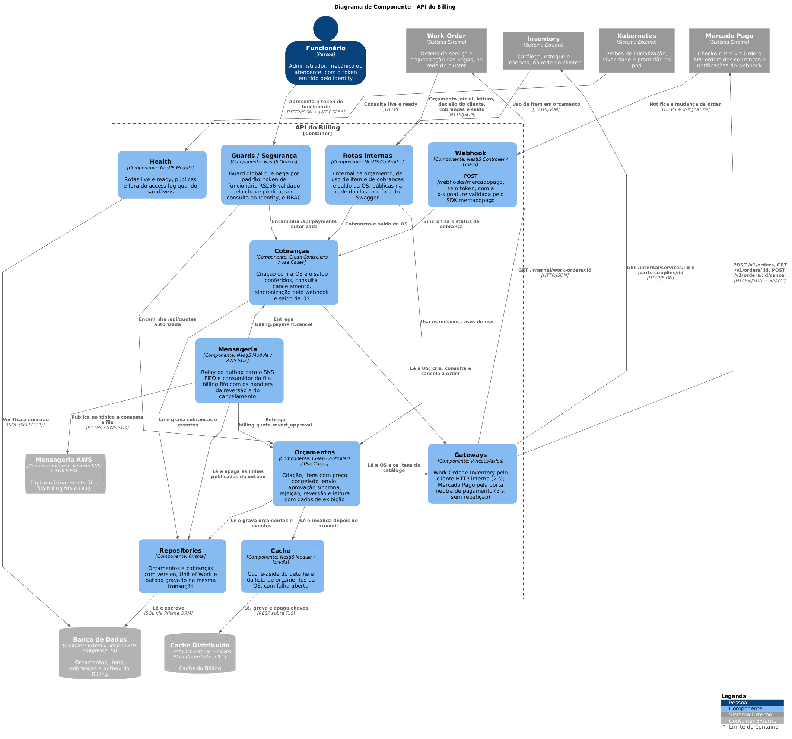

# 🏛️ Arquitetura

O Billing é um serviço NestJS em Clean Architecture, dono do próprio PostgreSQL e do próprio cache, e dono dos orçamentos e das cobranças da oficina. Ele nasceu do esqueleto do Work Order: o kit de infraestrutura é o mesmo dos outros serviços NestJS da solução, e as diferenças do kit se limitam a nomes, fila, configuração e catálogos.

<p align="center"></p>

## Índice

- [Camadas](#camadas)
- [Cerca de camadas](#cerca-de-camadas)
- [Domínio: orçamentos](#domínio-orçamentos)
- [Política de status da OS](#política-de-status-da-os)
- [Aprovação síncrona](#aprovação-síncrona)
- [Domínio: cobranças](#domínio-cobranças)
- [Cobranças com o Mercado Pago](#cobranças-com-o-mercado-pago)
- [Concorrência](#concorrência)
- [Integrações](#integrações)
- [Kit comum](#kit-comum)
- [Autenticação](#autenticação)
- [Mensageria](#mensageria)
- [Cache e chamadas internas](#cache-e-chamadas-internas)
- [Health checks e encerramento](#health-checks-e-encerramento)
- [Exceções por camada](#exceções-por-camada)
- [Diagrama de componentes (C4 nível 3)](#diagrama-de-componentes-c4-nível-3)
- [Decisões de arquitetura](#decisões-de-arquitetura)

## Camadas

As dependências de código apontam só para dentro. A árvore é relativa a `app/src/`.

```text
domain/                 Regra de negócio pura, sem framework nem ORM
  entities/             Quote (agregado), QuoteService, QuotePartSupply e Payment (agregado da cobrança)
  value-objects/        LineItemPrice (quantidade e preço unitário de um item)
  enums/                QuoteStatus, QuoteDecisionAction, PaymentStatus (com FinalPaymentStatus, os status que encerram a cobrança) e UserRole (papéis do token de funcionário)
  constants/validation/ Limites de validação do orçamento e da cobrança
  exceptions/           Exceções de domínio
  interfaces/           IQuoteRepository, IPaymentRepository, IOutboxRepository, IUnitOfWork e o contrato de paginação
  messaging/            Catálogo tipado e fechado das mensagens da solução
application/            Orquestração, livre de framework
  use-cases/quote/      Casos de uso dos orçamentos, um por operação
  use-cases/payment/    Casos de uso das cobranças: criação, consulta, cancelamento, sincronização pelo webhook, cobranças e saldo da OS
  policies/             QuoteWorkOrderPolicy (status da OS e orçamento APPROVED na OS)
  services/             QuoteItemValidator (itens e preços lidos no Inventory), WorkOrderBalanceReader (saldo da OS) e PaymentCloser (encerramento da cobrança)
  keys/, mappers/       Chaves de cache (billingCacheKeys), formato do valor em cache e CheckoutStatusMapper (status do checkout para o da cobrança)
  utils/                Paginação e leitura da duração ISO 8601 da expiração
  exceptions/           Exceções de aplicação (recurso não encontrado, conflito, chamada recusada)
  logging/              Catálogo de eventos de negócio dos orçamentos e das cobranças
  metrics/              Catálogo de métricas de negócio das cobranças
  messaging/            Envelope das mensagens
  auth/                 Principal autenticado que os controllers passam aos casos de uso
  ports/input/          quote/ e payment/: interfaces dos casos de uso e DTOs de entrada
  ports/output/         services/ (ILogger, IMetrics, ICache) e gateways/ (work-order/, inventory/ e payment-provider/)
interface-adapters/     quote/ e payment/: Clean Controllers público e interno, Clean Controller do webhook, Presenters, requests/ e responses/
infrastructure/         Framework e serviços externos
  config/               Composição da borda (app-bootstrap) e Swagger
  http/                 Controllers finos (quote/, payment/, internal/, health/), guards (inclusive o da assinatura do webhook), estratégia JWT, decorators, filtros, pipes e interceptors
  persistence/prisma/   PrismaService, repositórios de orçamento, cobrança e outbox, mappers e Unit of Work (único ponto que importa o Prisma)
  gateways/             HttpWorkOrderGateway, HttpInventoryCatalogGateway e HttpMercadoPagoOrderGateway, no GatewaysModule
  messaging/            Clientes SNS/SQS, relay do outbox, consumidor, registro e handlers por domínio (handlers/quote/ e handlers/payment/)
  cache/                Adaptador Valkey (ioredis) da porta ICache
  clients/              Cliente HTTP interno (@nestjs/axios)
  logging/              Pino, dicionário de campos, redação e eventos técnicos
  telemetry/            Métricas e atributos de span do OpenTelemetry
  health/               Verificação do PostgreSQL e estado de prontidão
```

`src/otel.ts` é o preload do OpenTelemetry, carregado por `node --require` antes do `main`, e `src/main.ts` é o ponto de entrada do processo.

Uma rota segue o caminho do template: o `@Controller` fino de `infrastructure/http/` recebe a requisição e delega ao Clean Controller de `interface-adapters/`, que chama o caso de uso de `application/` e entrega o resultado ao Presenter. O caso de uso depende das interfaces de repositório de `domain/`, implementadas em `infrastructure/persistence/prisma/`. Use cases e Clean Controllers são classes sem `@Injectable`: o módulo Nest os compõe com `useFactory`.

## Cerca de camadas

A regra de dependência é verificada pelo ESLint (`app/eslint.config.mjs`), e uma violação falha o `npm run lint` e o job `Lint` do CI.

| Onde | Imports proibidos |
|---|---|
| `domain/` e `application/` | `@nestjs/*`, `@generated/*` (Prisma), `@opentelemetry/*`, `@aws-sdk/*`, `sqs-consumer`, `ioredis`, `mercadopago` |
| `interface-adapters/` | Os mesmos de `domain/` e `application/` |
| Todo `src/` fora de `infrastructure/persistence/prisma/` | `@generated/*` |

As camadas internas falam com o mundo externo só pelas portas de `application/ports/output/`; os adaptadores ficam em `infrastructure/`.

## Domínio: orçamentos

O agregado `Quote` guarda a OS só pelo id (`workOrderId`), os itens `QuoteService` e `QuotePartSupply` (id do item no Inventory, quantidade e preço unitário congelado), os totais em `DECIMAL(10,2)`, o status, as datas de envio e de decisão, o autor da decisão (`decidedBy`), o motivo da rejeição e `replacedByQuoteId`. As invariantes ficam na entidade:

- itens só mudam com o orçamento `PENDING`; peças exigem ao menos um serviço; um mesmo serviço ou peça não entra duas vezes;
- o envio exige ao menos um serviço e grava `sentAt`;
- aprovação e rejeição exigem `SENT` e gravam o autor; a rejeição grava o motivo;
- `rejectByApprovalOf` rejeita um orçamento `PENDING` ou `SENT` pela aprovação de outro, e `undoRejectionByApproval` o devolve a `SENT` (com `sentAt`) ou a `PENDING`;
- `revertApproval` só age sobre `APPROVED`;
- só orçamento `PENDING` pode ser apagado.

A violação de uma regra responde 409; o ciclo de vida completo está em [API › Ciclo de vida do orçamento](api.md#ciclo-de-vida-do-orçamento) e as tabelas, em [Banco de dados](database.md).

O preço vem do Inventory na inclusão: o `QuoteItemValidator` busca serviços e peças por id, em paralelo, e o item grava `basePrice` ou `salePrice`. Nome, descrição, SKU, unidade e categoria não são copiados: o Clean Controller os lê no Inventory a cada resposta, assim como o resumo da OS, lido no Work Order uma vez por OS distinta. Nas rotas que gravam, essas leituras vêm antes do caso de uso: com o dono fora do ar, a rota responde 503 sem gravar nada.

## Política de status da OS

A OS pertence ao Work Order, então a regra sobre o status dela é uma política do Billing (`QuoteWorkOrderPolicy`) sobre o status lido em `GET /internal/work-orders/:id`:

| Operação | Status da OS aceitos | Outra condição |
| --- | --- | --- |
| Criação pela rota pública e envio | `IN_DIAGNOSIS`, `AWAITING_APPROVAL`, `REJECTED` | Nenhum orçamento `APPROVED` na OS, por consulta no banco do Billing |
| Aprovação pelo funcionário | `AWAITING_APPROVAL` | Nenhum outro orçamento `APPROVED` na OS |
| Aprovação pela decisão do cliente | Não consulta a OS | Nenhum outro orçamento `APPROVED` na OS |
| Rejeição | Não consulta a OS | — |
| Orçamento inicial (`POST /internal/quotes`) | Não consulta a OS, que ainda não foi gravada | — |

Enquanto o orçamento aprovado aguarda a reserva de estoque, a OS continua em `AWAITING_APPROVAL`. A consulta de orçamento `APPROVED` fecha essa janela: nenhum orçamento novo nasce, é enviado e rejeitado no meio da reserva, o que levaria a OS a `REJECTED` e prenderia a Saga. Quando a aprovação é revertida para `SENT`, a OS volta a aceitar criação, envio e aprovação.

## Aprovação síncrona

Detalhes e alternativas no [ADR 0007](adr/0007-aprovacao-sincrona-com-irmaos-reversiveis.md).

<p align="center"></p>

Antes do caso de uso, o Clean Controller lê o orçamento e o resumo da OS que vai na resposta. O `UpdateQuoteStatusUseCase` (rota do funcionário) confere a OS em `AWAITING_APPROVAL` e delega ao `ApproveQuoteUseCase`; o `DecideQuoteUseCase` (decisão do cliente, pela rota interna) delega direto. Numa transação do Unit of Work, sem chamada HTTP no meio, o `ApproveQuoteUseCase`:

1. lê o orçamento com os itens e os orçamentos da OS;
2. responde 409 se outro orçamento da OS está `APPROVED`;
3. aprova o orçamento com o autor;
4. rejeita os outros orçamentos `PENDING` e `SENT` da OS com `replacedByQuoteId`, sem `billing.quote.rejected` por eles;
5. grava todos com `version`, em ordem de id;
6. grava `billing.quote.approved` no outbox, com os itens e o total.

Depois do commit, apaga as chaves de cache dos orçamentos alterados e da lista da OS, registra `quote.approved` e responde 200. A reserva de estoque e a mudança da OS seguem pela Saga do Work Order; se faltar estoque, o comando `billing.quote.revert_approval` desfaz a aprovação e restaura os orçamentos rejeitados por ela ([Mensageria › Reversão da aprovação](messaging.md#reversão-da-aprovação)).

A rejeição exige motivo, grava o autor e publica `billing.quote.rejected` com `remainingSentCount`, a contagem dos outros orçamentos `SENT` da OS feita na mesma transação.

A decisão do cliente chega pela rota interna e passa pelos mesmos casos de uso, sem consultar a OS; os dados de exibição dos itens da resposta são lidos no Inventory antes da decisão:

<p align="center"></p>

## Domínio: cobranças

Uma cobrança pede ao cliente o pagamento de parte ou de todo o orçamento aprovado da OS: um sinal antes do serviço, o saldo antes da entrega ou o valor inteiro de uma vez. O agregado `Payment` guarda a OS só pelo id (`workOrderId`), o valor em `DECIMAL(10,2)`, o status, o id e o link do checkout no provedor de pagamento (`checkoutId` e `checkoutUrl`), a expiração (`expiresAt`) e a `version`. O checkout é a página de pagamento que o provedor hospeda; no Mercado Pago, o `checkoutId` é o id da order, com um nome que não prende a entidade ao provedor. As invariantes ficam na entidade:

- a criação exige id e OS em UUID, valor maior que zero, `checkoutId` com até 64 caracteres, `checkoutUrl` em `https` e `expiresAt` no futuro;
- o valor não passa do saldo da OS (`ensureChargeableAmount`), e a violação responde 422;
- a cobrança nasce `PENDING` e é encerrada uma vez só, pelo `resolve`, em `APPROVED`, `EXPIRED`, `CANCELLED` ou `REJECTED` (o tipo `FinalPaymentStatus`); fora de `PENDING`, a transição responde 409.

O ciclo de vida completo está em [API › Ciclo de vida da cobrança](api.md#ciclo-de-vida-da-cobrança) e a tabela, em [Banco de dados](database.md).

## Cobranças com o Mercado Pago

Detalhes e alternativas no [ADR 0008](adr/0008-checkout-pro-via-orders-api.md), que escolhe o produto do Mercado Pago, e no [ADR 0009](adr/0009-webhook-com-hmac-e-consulta-da-order.md), que trata o webhook.

<p align="center"></p>

### Porta e adaptador

A aplicação fala com o provedor de pagamento pela porta `IPaymentProviderGateway` (`application/ports/output/gateways/payment-provider/`), que não carrega o nome do provedor: `createCheckout`, `findCheckoutById` e `cancelCheckout`, com o status neutro `CheckoutStatus`. O `CheckoutStatusMapper` leva o status do checkout ao status final da cobrança, e os status que não encerram a cobrança não têm par:

| Order do Mercado Pago | `CheckoutStatus` | Cobrança |
| --- | --- | --- |
| `created` | `OPEN` | Continua `PENDING` |
| `action_required`, `processing` | `IN_PROGRESS` (pagamento iniciado e não concluído) | Continua `PENDING` |
| `processed` | `PAID` | `APPROVED` |
| `expired` | `EXPIRED` | `EXPIRED` |
| `canceled` | `CANCELLED` | `CANCELLED` |
| `failed` | `FAILED` | `REJECTED` |
| `refunded`, `charged_back` | `REFUNDED`, `CHARGED_BACK` | Não muda; só registra `payment.checkout_reversed` |
| Outro status | `IN_PROGRESS` | Continua `PENDING` |

O adaptador `HttpMercadoPagoOrderGateway` (`infrastructure/gateways/mercado-pago/`) é o único que conhece o Mercado Pago. Ele chama a Orders API do Checkout Pro pelo `HttpService` do `@nestjs/axios`, em `MERCADOPAGO_API_URL`, com o access token como `Bearer`, prazo de 5 s, sem redirecionamento e sem repetição:

| Operação | Chamada | Detalhe |
| --- | --- | --- |
| `createCheckout` | `POST /v1/orders` | `type` `online`, `processing_mode` `manual`, `capture_mode` `automatic_async`, `total_amount` em texto com duas casas, `expiration_time` igual a `MERCADOPAGO_ORDER_EXPIRATION`, um item "Ordem de serviço `<número>`" e o id do `Payment` em `external_reference` e no cabeçalho `X-Idempotency-Key` |
| `findCheckoutById` | `GET /v1/orders/:id` | A order é a fonte da verdade do status |
| `cancelCheckout` | `POST /v1/orders/:id/cancel` | Uma `X-Idempotency-Key` nova a cada chamada, porque cancelar de novo uma order cancelada é inofensivo |

O `capture_mode` `automatic_async` é fixo no adaptador: o valor `automatic` liga o modo binário do Mercado Pago, que recusa pagamentos pendentes, como Pix e boleto gerados e ainda não pagos. No cancelamento, as respostas 400, 409 e 422 são recusa (`ServiceRequestRejectedException`) e levam à consulta da order; qualquer outra falha (sem resposta em 5 s, 423, 429, 5xx, outro 4xx ou uma criação sem `id` ou `checkout_url`) é indisponibilidade (`ServiceIntegrationException`, 503), com uma mensagem que não leva o token nem o corpo do erro. O SDK `mercadopago` só entra no webhook.

### Criação da cobrança

O `CreatePaymentUseCase`:

1. lê a OS em `GET /internal/work-orders/:id` e exige `APPROVED` ou `COMPLETED` (409; OS desconhecida, 404; Work Order fora do ar, 503);
2. lê o saldo pelo `WorkOrderBalanceReader` e responde 409 se a OS já tem cobrança `PENDING`;
3. exige o valor maior que zero e até o saldo (422);
4. gera o id do `Payment` e cria a order no Mercado Pago; com o Mercado Pago indisponível, responde 503 sem gravar nada;
5. numa transação, grava o `Payment` `PENDING` e `billing.payment.requested` no outbox;
6. depois do commit, incrementa `oficina.payment.requested`, registra `payment.requested` e responde 201 com o `checkoutUrl`.

O `expiresAt` é o instante da criação mais `MERCADOPAGO_ORDER_EXPIRATION`, uma duração ISO 8601 (`P1D`, `PT30M`) lida no boot: um valor fora desse formato impede a API de subir. Se a transação falhar depois da order criada, a order fica sem uso e expira sozinha no Mercado Pago; repetir a criação gera outro id e outra order.

### Saldo da OS

O `WorkOrderBalanceReader` lê, em paralelo, os orçamentos e as cobranças da OS no banco do Billing:

- `approvedTotal` é o total do orçamento `APPROVED` da OS, ou zero sem orçamento aprovado (e então toda cobrança é recusada com 422);
- `paidTotal` é a soma das cobranças `APPROVED`;
- `balance` é `approvedTotal - paidTotal`.

As contas são feitas em centavos inteiros, para a soma em ponto flutuante não perder centavos, e as rotas internas devolvem os três valores em texto com duas casas (`"400.00"`).

### Webhook do Mercado Pago

O Mercado Pago avisa cada mudança da order por `POST /webhooks/mercadopago`, com o id da order em `data.id` na query. A rota fica fora do prefixo `api`, é `@Public()` (sem token) e não aparece no Swagger; no cluster, o API Gateway a encaminha sem trocar o `x-request-id` nem a query, porque a assinatura é calculada sobre eles.

O `MercadoPagoSignatureGuard` valida o cabeçalho `x-signature` com o `WebhookSignatureValidator.validate` do SDK `mercadopago` 3.6.1: o manifest `id:<data.id em minúsculas>;request-id:<x-request-id>;ts:<ts>;` assinado em HMAC-SHA256 com a chave secreta do webhook (`MERCADOPAGO_WEBHOOK_SECRET`), comparado em tempo constante. Assinatura que não confere, `ts` ausente e `data.id` ausente ou repetido respondem 401, registram `payment.webhook.invalid_signature` com o motivo e contam `oficina.payment.webhook.received` com `outcome = invalid_signature`. A assinatura válida registra `payment.webhook.received`, conta `outcome = valid` e chama o `SyncPaymentStatusUseCase`:

1. busca a cobrança pelo `checkoutId`; sem cobrança, registra `payment.sync_skipped` e termina;
2. com a cobrança `EXPIRED`, `CANCELLED` ou `REJECTED`, registra `payment.sync_skipped` sem consultar o Mercado Pago;
3. com a cobrança `PENDING` ou `APPROVED`, consulta a order. Estorno e chargeback (`REFUNDED`, `CHARGED_BACK`) só registram `payment.checkout_reversed`, também na cobrança `APPROVED`, que por isso continua sendo consultada; a cobrança `PENDING` com a order encerrada vai ao status final pelo `PaymentCloser`; o resto registra `payment.sync_skipped`.

A resposta é 200 depois de processar: uma consulta e uma transação, bem abaixo do tempo que o Mercado Pago espera. Uma notificação repetida não muda nada, porque só a cobrança `PENDING` é encerrada. Com o Mercado Pago fora do ar na consulta, a rota responde 503 e o Mercado Pago repete a notificação.

### Encerramento da cobrança

O `PaymentCloser` é o único caminho que encerra uma cobrança, usado pelo webhook e pelo cancelamento. Numa transação, grava o status final com a `version` lida e o evento no outbox: `billing.payment.approved` (com `amount` e `paidAt`) para `APPROVED` e `billing.payment.failed` (com o motivo `EXPIRED`, `CANCELLED` ou `REJECTED`) para os outros. Depois do commit, conta `oficina.payment.resolved` com `oficina.payment.status` e registra `payment.approved`, `payment.cancelled` ou `payment.failed`.

### Cancelamento

O `CancelPaymentUseCase` atende à rota `POST /api/payments/:id/cancellations` e ao handler de `billing.payment.cancel`. Cobrança inexistente responde 404; fora de `PENDING`, 409 com `payment.cancellation_skipped`. Com a cobrança `PENDING`, ele cancela a order: aceito o cancelamento, o `PaymentCloser` grava `CANCELLED` e a rota responde 200. Se o Mercado Pago recusar, a order já mudou, e o status dela decide:

| Order consultada | Cobrança e evento | Rota | Handler |
| --- | --- | --- | --- |
| `expired`, `canceled` ou `failed` | `EXPIRED`, `CANCELLED` ou `REJECTED`; `billing.payment.failed` com o motivo | 200 com a cobrança | Confirma |
| `processed` | `APPROVED`; `billing.payment.approved` | 409 "A cobrança não pode ser cancelada porque já foi paga" | Confirma |
| `action_required` ou `processing` (pagamento iniciado e não concluído) | Continua `PENDING`, sem evento; `payment.cancellation_skipped` | 409 "A cobrança não pode ser cancelada enquanto o pagamento iniciado pelo cliente no provedor de pagamento não for concluído. Ela será encerrada quando esse pagamento for confirmado ou expirar" | Confirma; o desfecho chega pelo webhook |

A order expirada sem webhook é o caso em que o funcionário encerra uma cobrança presa: o cancelamento é recusado, a consulta mostra `expired` e a cobrança fica `EXPIRED` ([Runbook › Cobrança presa](runbook.md#cobrança-presa)). Com a order ainda aberta, a cobrança nunca vira `CANCELLED` só no Billing: o cliente poderia pagar depois, o pagamento ficaria fora do saldo e a vaga de cobrança pendente permitiria uma segunda cobrança.

### Papel na Saga de cobrança

A Saga de cobrança é orquestrada pelo Work Order, e o Billing é o participante que fala com o Mercado Pago. Ele publica, pelo outbox, `billing.payment.requested` com o link de pagamento e o desfecho de cada cobrança (`billing.payment.approved` ou `billing.payment.failed`), atende ao comando `billing.payment.cancel` com o mesmo cancelamento da rota e serve as cobranças e o saldo da OS nas rotas internas `/internal/work-orders/:workOrderId/payments` e `/balance`. O formato das mensagens está em [Mensageria](messaging.md#eventos-publicados).

## Concorrência

Cada escrita de `quotes` e de `payments` filtra pela `version` lida e a incrementa; uma escrita sobre versão velha responde 409.

- **Aprovação e reversão** gravam o orçamento e os outros orçamentos que alteram, todos com `version` e em ordem de id. Duas aprovações de orçamentos diferentes da mesma OS escrevem as mesmas linhas: a segunda falha pela versão e responde 409, e a ordem por id faz uma esperar a outra em vez de entrar em deadlock. A consulta de orçamento `APPROVED` roda sem lock (`READ COMMITTED`): quem protege a corrida é a `version`.
- **Envio** lê o orçamento e a OS fora da transação, porque chama o Work Order e o Inventory, e grava com a `version` lida. Uma inclusão de item ou a aprovação de outro orçamento da OS depois da leitura muda a versão, e o envio responde 409.
- **Unit of Work só onde há várias escritas ou outbox:** envio, aprovação, rejeição, reversão e itens (o item e a `version` do orçamento). Criação, orçamento inicial e exclusão fazem uma escrita só e usam o repositório direto: uma leitura sem lock dentro da transação não protegeria nada a mais.
- **Itens em corrida:** duas inclusões do mesmo item, duas remoções ou uma remoção junto com a alteração de quantidade respondem 409, como a versão velha.
- **Uma cobrança pendente por OS:** a criação confere a cobrança `PENDING` fora da transação, porque chama o Work Order e o Mercado Pago; duas criações simultâneas para a mesma OS passam as duas pela conferência, e a segunda falha no índice único parcial `payments(work_order_id) WHERE status = 'PENDING'` e responde 409. A order dela fica sem uso e expira no Mercado Pago.
- **Webhook e cancelamento da mesma cobrança:** os dois encerram pelo `PaymentCloser`, com a `version`. O segundo a gravar falha pela versão: a rota responde 409, o webhook responde 409 e o Mercado Pago repete a notificação, e o comando não é confirmado e volta pela fila; na nova tentativa, a cobrança já está fora de `PENDING`.

## Integrações

| Direção | Serviço | Rotas ou mensagens | Para quê |
| --- | --- | --- | --- |
| Billing chama | Work Order | `GET /internal/work-orders/:id` | Status da OS (política) e resumo da OS nas respostas públicas |
| Billing chama | Inventory | `GET /internal/services/:id`, `GET /internal/parts-supplies/:id` | Preço na inclusão do item, nomes no envio e dados de exibição na leitura |
| Billing chama | Mercado Pago | `POST /v1/orders`, `GET /v1/orders/:id`, `POST /v1/orders/:id/cancel` | Criar, consultar e cancelar a order de cada cobrança |
| Chama o Billing | Work Order | `POST /internal/quotes`, `DELETE` e `GET /internal/quotes/:id`, `GET /internal/work-orders/:workOrderId/quotes`, `POST /internal/quotes/:id/decisions`, `GET /internal/work-orders/:workOrderId/payments`, `GET /internal/work-orders/:workOrderId/balance` | Orçamento inicial e compensação da abertura, leitura pela Saga, decisão do cliente, cobranças e saldo da OS |
| Chama o Billing | Mercado Pago | `POST /webhooks/mercadopago` | Avisar a mudança de uma order |
| Chama o Billing | Inventory | `GET /internal/services/:serviceId/quote-usage`, `GET /internal/parts-supplies/:partSupplyId/quote-usage` | Saber se o item é usado em orçamento antes de excluí-lo |
| Billing publica | Work Order | `billing.quote.sent`, `billing.quote.approved`, `billing.quote.rejected`, `billing.quote.approval_reverted` | Avisar o cliente, conduzir a Saga de aprovação e decidir a OS |
| Billing publica | Work Order | `billing.payment.requested`, `billing.payment.approved`, `billing.payment.failed` | Conduzir a Saga de cobrança |
| Billing consome | Work Order | `billing.quote.revert_approval`, `billing.payment.cancel` | Desfazer a aprovação e cancelar a cobrança |

Cada serviço chamado tem um gateway: a porta em `application/ports/output/gateways/<dono>/` (`IWorkOrderGateway` e `IInventoryCatalogGateway`, com as respostas do dono nos tipos `*GatewayResponse`) e o adaptador em `infrastructure/gateways/<dono>/` (`HttpWorkOrderGateway` e `HttpInventoryCatalogGateway`), registrados no `GatewaysModule`. As URLs vêm de `WORK_ORDER_SERVICE_URL` e `INVENTORY_SERVICE_URL`, obrigatórias: sem elas a API não sobe. O 404 do dono vira 404 do recurso, ou item sem dados de exibição na leitura; prazo, erro de conexão e 5xx viram 503. Outro 4xx do Work Order é repassado com o status dele; no Inventory, vira 503. O domínio nunca recebe o formato do dono: o caso de uso ou o presenter o traduz.

O Mercado Pago, um provedor externo que pode ser trocado, segue outra regra: a porta `IPaymentProviderGateway` é neutra, com os tipos e os status da aplicação, e só o adaptador `HttpMercadoPagoOrderGateway`, também no `GatewaysModule`, conhece o formato do provedor ([Cobranças com o Mercado Pago](#porta-e-adaptador)). As credenciais vêm de `MERCADOPAGO_ACCESS_TOKEN` e `MERCADOPAGO_WEBHOOK_SECRET`, lidas no boot; vazias, a API sobe e as rotas de cobrança respondem 503.

As rotas internas do Billing ficam fora do prefixo `api`, são `@Public()` e não aparecem no Swagger; as respostas delas estão versionadas em `app/test/contracts/` ([API › Rotas internas](api.md#rotas-internas-internal)).

## Kit comum

O kit é igual ao do Work Order e dos outros serviços NestJS. O catálogo de eventos de negócio tem os eventos dos orçamentos e das cobranças, e o de métricas de negócio, as métricas das cobranças (`oficina.payment.requested` e `oficina.payment.resolved`). A contagem dos webhooks (`oficina.payment.webhook.received`) é técnica e fica no guard, pela API do OpenTelemetry. Nenhuma métrica leva id em atributo.

| Componente | Onde | O que faz |
|---|---|---|
| Logging estruturado | `infrastructure/logging/` | Uma linha JSON por evento no stdout, nomes de atributo do OpenTelemetry, `request.id` em toda linha, redação de segredo e PII por nome de campo e por forma do valor |
| Telemetria | `src/otel.ts`, `infrastructure/telemetry/` | Traces e métricas pelo SDK do OpenTelemetry, ligados só com `OTEL_EXPORTER_OTLP_ENDPOINT`; correlação log-trace por `trace_id` |
| Health checks | `infrastructure/health/`, `infrastructure/http/controllers/health/` | `/api/health/live` sem I/O e `/api/health/ready` com `SELECT 1`, consumidos pelas probes do Kubernetes |
| Outbox e relay | `infrastructure/persistence/prisma/repositories/`, `infrastructure/messaging/` | Mensagem gravada na mesma transação do estado e publicada no SNS pelo relay |
| Consumidor | `infrastructure/messaging/` | Lê a fila `billing.fifo` e entrega cada mensagem ao handler registrado para o tipo |
| Cache | `infrastructure/cache/` | Porta `ICache` sobre o Valkey, cache-aside que falha aberto |
| Cliente interno | `infrastructure/clients/` | `InternalHttpClient`, transporte que os gateways usam para as rotas `/internal` dos outros serviços |
| Paginação | `infrastructure/http/common/dto/`, `infrastructure/persistence/prisma/helpers/` | Query `page` e `limit` e envelope `{ data, pagination }` da listagem |
| Autenticação | `infrastructure/http/{guards,strategies,decorators}/` | Guard global com o token de funcionário, `@Public()` e `@Roles()` |
| Exceções | `infrastructure/http/filters/` | Um filtro global por camada, com corpo de erro público fixo |

Ficam fora do Billing, de propósito: validadores de CPF/CNPJ, login, e-mail e token de cliente.

## Autenticação

Toda rota exige o token de funcionário, exceto as marcadas com `@Public()` (health, as rotas `/internal` e o webhook do Mercado Pago, autenticado pela assinatura `x-signature` no `MercadoPagoSignatureGuard`); o Swagger fica fora do router do Nest e não passa pelo guard. O `AuthenticationGuard` global aplica o `JwtAuthGuard`, e a `JwtStrategy` valida o token só pela configuração, sem consultar o Identity:

- algoritmo `RS256` e assinatura pela `STAFF_JWT_PUBLIC_KEY`, com o `kid` do cabeçalho igual a `STAFF_JWT_KEY_ID`;
- `iss = STAFF_JWT_ISSUER` (`oficina-identity`), `aud = STAFF_JWT_AUDIENCE` (`oficina-services`), `typ = access` e `exp` obrigatório;
- `role` presente e entre os valores de `UserRole` (`ADMIN`, `MECHANIC`, `ATTENDANT`).

Qualquer falha responde `401`, inclusive o token de cliente, que tem outro emissor, outra audiência e outra chave. O `RolesGuard` com `@Roles()` restringe por papel e responde `403`. O principal autenticado chega ao controller pelo `@CurrentPrincipal()`.

O Billing não guarda chave privada: só o Identity assina tokens.

## Mensageria

Detalhes e alternativas no [ADR 0005](adr/0005-mensageria-sns-sqs-fifo-com-outbox.md).

### Outbox e relay

Uma mensagem nunca é publicada por um caso de uso. Ela é uma linha da tabela `outbox`, gravada pelo `IOutboxRepository` dentro da mesma transação do `IUnitOfWork` que muda o estado. O tipo e o payload vêm do catálogo fechado de `domain/messaging/`, e o contexto W3C do trace é capturado na gravação.

O `OutboxRelayService` roda a cada 500 ms. Cada lote abre uma transação, toma `pg_try_advisory_xact_lock` (só uma réplica publica por vez), lê até 10 linhas pelo `id`, publica uma a uma no tópico `oficina-events.fifo` (`MessageGroupId` = `workOrderId`, ou o `messageId` quando a mensagem não tem OS; `MessageDeduplicationId` = `messageId`) e apaga as publicadas na mesma transação. Na primeira falha o lote para, para não furar a ordem da fila.

### Consumo

O `SqsConsumerService` lê a fila `billing.fifo` (`BILLING_QUEUE_NAME`), uma mensagem por vez, valida o envelope e entrega ao handler registrado para o `type` no `MessageHandlerRegistry`. A mensagem só é confirmada quando o handler termina sem erro.

A filter policy da fila só roteia os tipos do contexto, e o Billing registra um handler para cada um ([Mensageria](messaging.md#comandos-consumidos)): `billing.quote.revert_approval` no `QuoteMessagingModule` e `billing.payment.cancel` no `PaymentMessagingModule`, ambos em `infrastructure/messaging/handlers/<domínio>/`. Cada módulo compõe a classe de handlers do domínio com o `MessageHandlerRegistry` e os casos de uso, e os payloads são validados pelas classes de `dto/` antes do handler. Uma mensagem que o handler não processa (payload inválido, falha) **não** é confirmada: a fila a reentrega e o SQS a move para a `billing-dlq.fifo` na quinta entrega, onde ela fica para redrive (`messaging.message.dead_lettered` no log). Um tipo sem handler segue o mesmo caminho, com `messaging.message.unhandled`.

`BILLING_QUEUE_NAME` e `MESSAGING_TOPIC_ARN` são obrigatórias: sem elas a API não sobe.

## Cache e chamadas internas

O cache segue o [ADR 0006](adr/0006-cache-do-dono-no-elasticache.md): cache-aside no Valkey do próprio serviço, só para os dados de que o Billing é dono, com invalidação no caso de uso depois do commit. As chaves em uso são o detalhe do orçamento (`billing:quote:<id>`) e a lista da OS (`billing:work-order-quotes:<workOrderId>`) ([Banco de dados › Cache](database.md#cache)). As cobranças não usam cache: o status muda pelo webhook, e uma invalidação que falhasse mostraria `PENDING` numa cobrança já paga. O `ValkeyCacheAdapter` roda sem fila offline, com uma tentativa e prazo de 500 ms por comando; falha de leitura vira falta (`cache.unavailable`) e falha de exclusão espera o TTL (`cache.invalidation_failed`). `CACHE_URL` é obrigatória e `CACHE_TTL_SECONDS` precisa ser inteiro maior que zero (vazio = 12 h).

As chamadas a outros serviços passam por um gateway por serviço dono (porta em `application/ports/output/gateways/<dono>/`, adaptador em `infrastructure/gateways/<dono>/`), que usa o `InternalHttpClient`: prazo padrão de 2 s, sem retentativa e sem redirecionamento, com `x-request-id` da requisição corrente e o `traceparent` injetado pela instrumentação HTTP. Um `4xx` do dono vira `ServiceRequestRejectedException`; prazo, erro de conexão e `5xx` viram `503`.

## Health checks e encerramento

| Rota | Verifica | Usada por |
|---|---|---|
| `GET /api/health/live` | Nada além do processo | `startupProbe` e `livenessProbe` |
| `GET /api/health/ready` | `SELECT 1` no PostgreSQL e o estado de encerramento | `readinessProbe` |

O Valkey e o LocalStack ficam fora da prontidão: o cache falha aberto e o consumidor tenta de novo sozinho, então nenhum dos dois deve tirar a réplica do balanceamento. No `SIGTERM`, `/ready` passa a `503`, o relay e o consumidor param depois de terminar o que está em andamento e só então o pool do banco é fechado.

## Exceções por camada

Cada camada tem a própria hierarquia de exceções e um `APP_FILTER` global que a traduz em status HTTP: domínio, aplicação, infraestrutura e o `AllExceptionsFilter` para o resto. O corpo de erro é o mesmo em todos os serviços, com a mensagem em português, e nunca carrega stack, host ou texto do driver.

## Diagrama de componentes (C4 nível 3)

<p align="center"></p>

A descrição de cada componente e dos elementos externos está em [`docs/c4/`](c4/README.md).

## Decisões de arquitetura

| ADR | Decisão |
|---|---|
| [0001](adr/0001-clean-architecture-em-camadas.md) | Clean Architecture em camadas, com cerca de ESLint |
| [0002](adr/0002-pipelines-ci-cd-sast-dast-com-rollback.md) | Pipelines de CI, CD, SAST e DAST, com rollback e DAST com JWT de teste |
| [0003](adr/0003-testcontainers-com-postgresql-valkey-e-localstack.md) | E2E com Testcontainers: PostgreSQL, Valkey e LocalStack |
| [0004](adr/0004-materializacao-da-credencial-do-banco-no-cd.md) | Materialização da credencial do banco no CD |
| [0005](adr/0005-mensageria-sns-sqs-fifo-com-outbox.md) | Mensageria SNS/SQS FIFO com outbox transacional |
| [0006](adr/0006-cache-do-dono-no-elasticache.md) | Cache do dono no ElastiCache |
| [0007](adr/0007-aprovacao-sincrona-com-irmaos-reversiveis.md) | Aprovação síncrona com irmãos reversíveis |
| [0008](adr/0008-checkout-pro-via-orders-api.md) | Checkout Pro via Orders API, atrás de uma porta neutra |
| [0009](adr/0009-webhook-com-hmac-e-consulta-da-order.md) | Webhook com HMAC e consulta da order, sem reconciliador |
