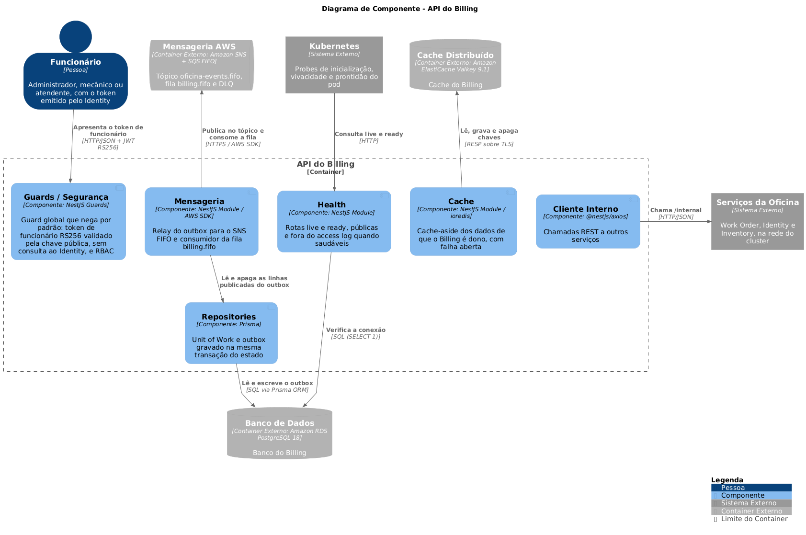

# 🏛️ Arquitetura

O Billing é um serviço NestJS em Clean Architecture, dono do próprio PostgreSQL e do próprio cache. Ele nasceu do esqueleto do Work Order sem o domínio: o kit de infraestrutura é o mesmo dos outros serviços NestJS da solução, e as diferenças se limitam a nomes, fila, configuração e catálogos.

## Índice

- [Camadas](#camadas)
- [Cerca de camadas](#cerca-de-camadas)
- [Kit comum](#kit-comum)
- [Autenticação](#autenticação)
- [Mensageria](#mensageria)
- [Cache e chamadas internas](#cache-e-chamadas-internas)
- [Health checks e encerramento](#health-checks-e-encerramento)
- [Exceções por camada](#exceções-por-camada)
- [Diagrama de componentes (C4 nível 3)](#diagrama-de-componentes-c4-nível-3)
- [Decisões de arquitetura](#decisões-de-arquitetura)

## Camadas

As dependências de código apontam só para dentro. A árvore é relativa a `app/src/`.

```text
domain/                 Regra de negócio pura, sem framework nem ORM
  enums/                UserRole (papéis do token de funcionário)
  exceptions/           Exceções de domínio
  interfaces/repositories/  IOutboxRepository e IUnitOfWork
  messaging/            Catálogo tipado e fechado das mensagens da solução
application/            Orquestração, livre de framework
  exceptions/           Exceções de aplicação (recurso não encontrado, conflito, chamada recusada)
  logging/              Catálogo de eventos de negócio (vazio até o primeiro caso de uso)
  metrics/              Catálogo de métricas de negócio (vazio até a primeira métrica)
  messaging/            Envelope das mensagens
  ports/output/         ILogger, IMetrics, ICache, IInternalHttpClient e o principal autenticado
interface-adapters/     Clean Controllers e Presenters (POJOs); vazia até o primeiro domínio
infrastructure/         Framework e serviços externos
  config/               Composição da borda (app-bootstrap) e Swagger
  http/                 Controllers finos, guards, estratégia JWT, decorators, filtros, pipes e interceptors
  persistence/prisma/   PrismaService, outbox e Unit of Work (único ponto que importa o Prisma)
  messaging/            Clientes SNS/SQS, relay do outbox, consumidor e registro de handlers
  cache/                Adaptador Valkey (ioredis) da porta ICache
  clients/              Cliente HTTP interno (@nestjs/axios)
  logging/              Pino, dicionário de campos, redação e eventos técnicos
  telemetry/            Métricas e atributos de span do OpenTelemetry
  health/               Verificação do PostgreSQL e estado de prontidão
```

`src/otel.ts` é o preload do OpenTelemetry, carregado por `node --require` antes do `main`, e `src/main.ts` é o ponto de entrada do processo.

Uma rota nova segue o caminho do template: o `@Controller` fino de `infrastructure/http/` recebe a requisição e delega ao Clean Controller de `interface-adapters/`, que chama o caso de uso de `application/` e entrega o resultado ao Presenter. O caso de uso depende das interfaces de repositório de `domain/`, implementadas em `infrastructure/persistence/prisma/`. Use cases e Clean Controllers são classes sem `@Injectable`: o módulo Nest os compõe com `useFactory`.

## Cerca de camadas

A regra de dependência é verificada pelo ESLint (`app/eslint.config.mjs`), e uma violação falha o `npm run lint` e o job `Lint` do CI.

| Onde | Imports proibidos |
|---|---|
| `domain/` e `application/` | `@nestjs/*`, `@generated/*` (Prisma), `@opentelemetry/*`, `@aws-sdk/*`, `sqs-consumer`, `ioredis`, `mercadopago` |
| `interface-adapters/` | Os mesmos de `domain/` e `application/` |
| Todo `src/` fora de `infrastructure/persistence/prisma/` | `@generated/*` |

As camadas internas falam com o mundo externo só pelas portas de `application/ports/output/`; os adaptadores ficam em `infrastructure/`.

## Kit comum

O kit é igual ao do Work Order e dos outros serviços NestJS. O Billing usa os mecanismos com os catálogos de negócio vazios: o primeiro caso de uso acrescenta as entradas.

| Componente | Onde | O que faz |
|---|---|---|
| Logging estruturado | `infrastructure/logging/` | Uma linha JSON por evento no stdout, nomes de atributo do OpenTelemetry, `request.id` em toda linha, redação de segredo e PII por nome de campo e por forma do valor |
| Telemetria | `src/otel.ts`, `infrastructure/telemetry/` | Traces e métricas pelo SDK do OpenTelemetry, ligados só com `OTEL_EXPORTER_OTLP_ENDPOINT`; correlação log-trace por `trace_id` |
| Health checks | `infrastructure/health/`, `infrastructure/http/controllers/health/` | `/api/health/live` sem I/O e `/api/health/ready` com `SELECT 1`, consumidos pelas probes do Kubernetes |
| Outbox e relay | `infrastructure/persistence/prisma/repositories/`, `infrastructure/messaging/` | Mensagem gravada na mesma transação do estado e publicada no SNS pelo relay |
| Consumidor | `infrastructure/messaging/` | Lê a fila `billing.fifo` e entrega cada mensagem ao handler registrado para o tipo |
| Cache | `infrastructure/cache/` | Porta `ICache` sobre o Valkey, cache-aside que falha aberto |
| Cliente interno | `infrastructure/clients/` | Porta `IInternalHttpClient` para as rotas `/internal` dos outros serviços |
| Autenticação | `infrastructure/http/{guards,strategies,decorators}/` | Guard global com o token de funcionário, `@Public()` e `@Roles()` |
| Exceções | `infrastructure/http/filters/` | Um filtro global por camada, com corpo de erro público fixo |

Ficam fora do Billing, até alguma rota precisar: rotas `/internal` e fixtures de contrato, paginação, validadores de CPF/CNPJ, login, e-mail e token de cliente.

## Autenticação

Toda rota exige o token de funcionário, exceto as marcadas com `@Public()` (health e Swagger). O `AuthenticationGuard` global aplica o `JwtAuthGuard`, e a `JwtStrategy` valida o token só pela configuração, sem consultar o Identity:

- algoritmo `RS256` e assinatura pela `STAFF_JWT_PUBLIC_KEY`, com o `kid` do cabeçalho igual a `STAFF_JWT_KEY_ID`;
- `iss = STAFF_JWT_ISSUER` (`oficina-identity`), `aud = STAFF_JWT_AUDIENCE` (`oficina-services`), `typ = access` e `exp` obrigatório;
- `role` presente e entre os valores de `UserRole` (`ADMIN`, `MECHANIC`, `ATTENDANT`).

Qualquer falha responde `401`, inclusive o token de cliente, que tem outro emissor, outra audiência e outra chave. O `RolesGuard` com `@Roles()` restringe por papel e responde `403`. O principal autenticado chega ao controller pelo `@CurrentPrincipal()`.

O Billing não guarda chave privada: só o Identity assina tokens.

## Mensageria

Detalhes e alternativas no [ADR 0005](adr/0005-mensageria-sns-sqs-fifo-com-outbox.md).

### Outbox e relay

Uma mensagem nunca é publicada por um caso de uso. Ela é uma linha da tabela `outbox`, gravada pelo `IOutboxRepository` dentro da mesma transação do `IUnitOfWork` que muda o estado. O tipo e o payload vêm do catálogo fechado de `domain/messaging/`, e o contexto W3C do trace é capturado na gravação.

O `OutboxRelayService` roda a cada 500 ms. Cada lote abre uma transação, toma `pg_try_advisory_xact_lock` (só uma réplica publica por vez), lê até 10 linhas pelo `id`, publica uma a uma no tópico `oficina-events.fifo` (`MessageGroupId` = `workOrderId`, `MessageDeduplicationId` = `messageId`) e apaga as publicadas na mesma transação. Na primeira falha o lote para, para não furar a ordem da fila.

### Consumo

O `SqsConsumerService` lê a fila `billing.fifo` (`BILLING_QUEUE_NAME`), uma mensagem por vez, valida o envelope e entrega ao handler registrado para o `type` no `MessageHandlerRegistry`. A mensagem só é confirmada quando o handler termina sem erro.

O Billing ainda não registra handler. A filter policy da fila só roteia os tipos do contexto (`billing.quote.revert_approval` e `billing.payment.cancel`), então uma mensagem sem handler é janela de deploy: o consumidor registra `messaging.message.unhandled`, **não** confirma, e o SQS a move para a `billing-dlq.fifo` na quinta entrega, onde ela fica para redrive (`messaging.message.dead_lettered` no log).

`BILLING_QUEUE_NAME` e `MESSAGING_TOPIC_ARN` são obrigatórias: sem elas a API não sobe.

## Cache e chamadas internas

O cache segue o [ADR 0006](adr/0006-cache-do-dono-no-elasticache.md): cache-aside no Valkey do próprio serviço, só para os dados de que o Billing é dono, com invalidação no caso de uso depois do commit. O `ValkeyCacheAdapter` roda sem fila offline, com uma tentativa e prazo de 500 ms por comando; falha de leitura vira falta (`cache.unavailable`) e falha de exclusão espera o TTL (`cache.invalidation_failed`). `CACHE_URL` é obrigatória e `CACHE_TTL_SECONDS` precisa ser inteiro maior que zero (vazio = 12 h).

As chamadas a outros serviços passam pelo `IInternalHttpClient`: prazo padrão de 2 s, sem retentativa e sem redirecionamento, com `x-request-id` da requisição corrente e o `traceparent` injetado pela instrumentação HTTP. Um `4xx` do dono vira `ServiceRequestRejectedException`; prazo, erro de conexão e `5xx` viram `503`.

## Health checks e encerramento

| Rota | Verifica | Usada por |
|---|---|---|
| `GET /api/health/live` | Nada além do processo | `startupProbe` e `livenessProbe` |
| `GET /api/health/ready` | `SELECT 1` no PostgreSQL e o estado de encerramento | `readinessProbe` |

O Valkey e o LocalStack ficam fora da prontidão: o cache falha aberto e o consumidor tenta de novo sozinho, então nenhum dos dois deve tirar a réplica do balanceamento. No `SIGTERM`, `/ready` passa a `503`, o relay e o consumidor param depois de terminar o que está em andamento e só então o pool do banco é fechado.

## Exceções por camada

Cada camada tem a própria hierarquia de exceções e um `APP_FILTER` global que a traduz em status HTTP: domínio, aplicação, infraestrutura e o `AllExceptionsFilter` para o resto. O corpo de erro é o mesmo em todos os serviços, com a mensagem em português, e nunca carrega stack, host ou texto do driver.

## Diagrama de componentes (C4 nível 3)

<p align="center"></p>

A descrição de cada componente e dos elementos externos está em [`docs/c4/`](c4/README.md).

## Decisões de arquitetura

| ADR | Decisão |
|---|---|
| [0001](adr/0001-clean-architecture-em-camadas.md) | Clean Architecture em camadas, com cerca de ESLint |
| [0002](adr/0002-pipelines-ci-cd-sast-dast-com-rollback.md) | Pipelines de CI, CD, SAST e DAST, com rollback e DAST com JWT de teste |
| [0003](adr/0003-testcontainers-com-postgresql-valkey-e-localstack.md) | E2E com Testcontainers: PostgreSQL, Valkey e LocalStack |
| [0004](adr/0004-materializacao-da-credencial-do-banco-no-cd.md) | Materialização da credencial do banco no CD |
| [0005](adr/0005-mensageria-sns-sqs-fifo-com-outbox.md) | Mensageria SNS/SQS FIFO com outbox transacional |
| [0006](adr/0006-cache-do-dono-no-elasticache.md) | Cache do dono no ElastiCache |
