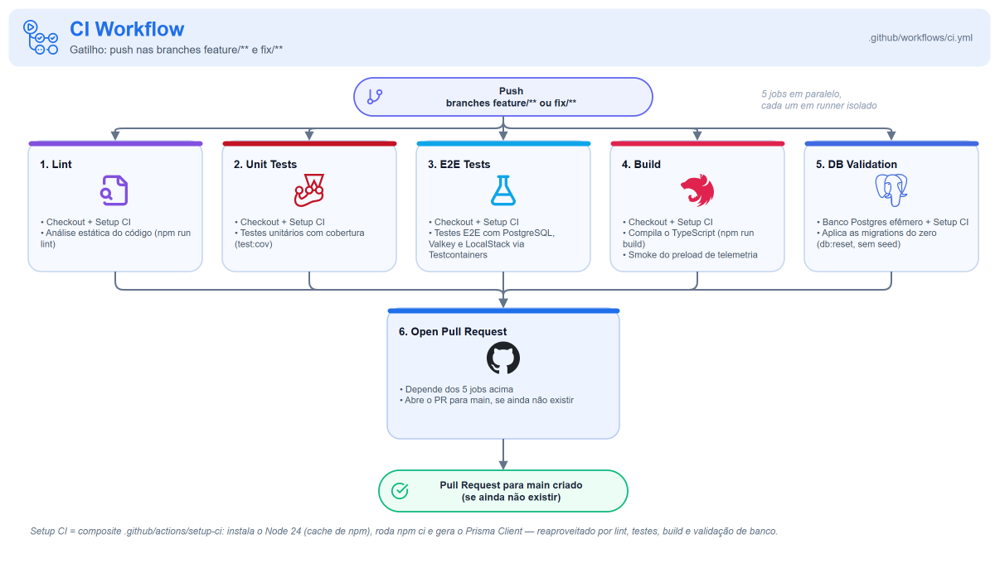
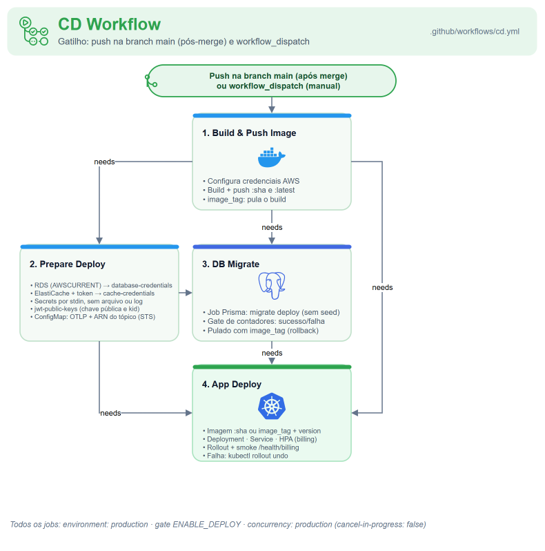
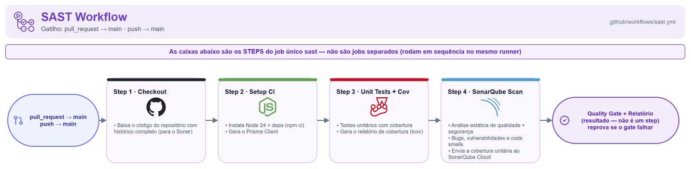
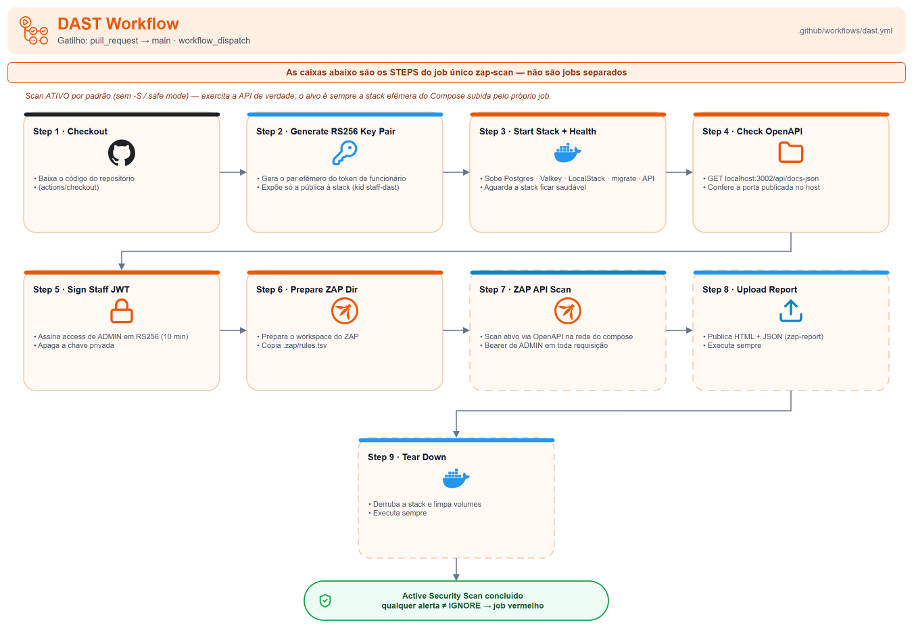

# 🔄 CI/CD

Quatro workflows do GitHub Actions, um por responsabilidade: CI, CD, SAST e DAST. A infraestrutura (rede, cluster, banco, cache, filas e gateway) não é provisionada aqui: vive nos repositórios de Terraform da solução.

## Índice

- [Visão geral](#visão-geral)
- [Fluxo de branch e Pull Request](#fluxo-de-branch-e-pull-request)
- [1) Workflow de CI](#1-workflow-de-ci-ciyml)
- [2) Workflow de CD](#2-workflow-de-cd-cdyml)
- [3) Workflow de SAST](#3-workflow-de-sast-sastyml)
- [4) Workflow de DAST](#4-workflow-de-dast-dastyml)
- [Secrets e variables](#secrets-e-variables)

## Visão geral

| Workflow | Arquivo | Gatilho | Concorrência | Responsabilidade |
|---|---|---|---|---|
| CI | `.github/workflows/ci.yml` | `push` em `feature/**` e `fix/**` | `ci-<ref>`, cancela o anterior | Lint, testes, build e validação do banco; depois abre o PR |
| CD | `.github/workflows/cd.yml` | `push` em `main` e `workflow_dispatch` | `production`, sem cancelar | Imagem, credenciais, migração, deploy, smoke e rollback |
| SAST | `.github/workflows/sast.yml` | `pull_request` para `main` e `push` em `main` | `sast-<PR ou ref>`, cancela o anterior | SonarQube Cloud com o quality gate |
| DAST | `.github/workflows/dast.yml` | `pull_request` para `main` e `workflow_dispatch` | `dast-<PR ou ref>`, cancela o anterior | OWASP ZAP contra a API no stack do compose |

As actions de terceiros são fixadas pelo SHA do commit. Os jobs que precisam do Node usam o composite `.github/actions/setup-ci`: Node 24 com cache do npm, `npm ci` e `prisma generate` em `app/`.

> **Como ler os diagramas.** Nos de CI e CD, cada caixa é um job, com os principais steps, e as setas seguem o `needs:`. Nos de SAST e DAST, que têm um job só, cada caixa é um step, em sequência no mesmo runner.

## Fluxo de branch e Pull Request

O CI dispara no `push` de uma branch de trabalho e roda os jobs de validação em paralelo. Com todos verdes, o `Open Pull Request` abre o PR para a `main`, sem duplicar quando ele já existe. Os jobs pesados não disparam por `pull_request`: cada commit é validado uma vez, e os checks ficam no SHA, onde o ruleset da `main` os lê.

O ruleset da `main` exige PR e os checks `Lint`, `Unit Tests`, `E2E Tests`, `Build`, `SAST` e `OWASP ZAP API Scan`, sem bypass. O `DB Validation` roda no CI sem ser obrigatório. O merge é sempre humano.

## 1) Workflow de CI (`ci.yml`)

| Job | O que faz |
|---|---|
| `Lint` | `npm run lint`, com a cerca de camadas |
| `Unit Tests` | `npm run test:cov`; falha abaixo de 100% em qualquer métrica |
| `E2E Tests` | `npm run test:e2e:cov`, com PostgreSQL, Valkey e LocalStack por Testcontainers |
| `Build` | `npm run build` e `npm run test:smoke` (o preload de telemetria num processo real) |
| `DB Validation` | PostgreSQL 18 efêmero como service container e `npm run db:reset`: prova que as migrations aplicam do zero. Nunca toca um banco real |
| `Open Pull Request` | Depois dos cinco, abre o PR para a `main` autenticado pelo GitHub App do bot (`BOT_APP_ID` e `BOT_PRIVATE_KEY`), para o SAST e o DAST rodarem no PR desde o primeiro push |

## 2) Workflow de CD (`cd.yml`)

Todos os jobs rodam no environment `production` e só na `main`, com `vars.ENABLE_DEPLOY == 'true'` ou disparo manual.

| Job | O que faz |
|---|---|
| `Build and Push App Image` | Build da imagem com `SERVICE_VERSION` = SHA e push para o ECR com as tags do SHA e `latest`. Com `image_tag` no disparo manual, só confere que a imagem existe no ECR e não faz build |
| `Prepare Deployment Configuration` | Confere que `K8S_NAMESPACE` e `K8S_DEPLOYMENT_NAME` batem com os manifests e que `STAFF_JWT_PUBLIC_KEY` é uma chave pública PEM e `STAFF_JWT_KEY_ID` não está vazio; materializa `database-credentials` (RDS e `AWSCURRENT`) e `cache-credentials` (ElastiCache e `<id>-auth-token`); aplica `jwt-public-keys` e o ConfigMap `billing-config`, com o ARN do tópico montado pela conta da AWS |
| `DB Migrate` | Aplica o Job `k8s/00-db-migrate-job.yaml` com a imagem nova (`prisma migrate deploy`, sem seed), espera o fim e mostra o log. Pulado com `image_tag`: a imagem antiga não tem o que migrar |
| `App Deploy` | Renderiza o Deployment com a imagem e o rótulo `version`, aplica Service (NodePort 30082), HPA e Deployment no namespace `billing`, espera o `rollout status` e faz o smoke `GET /health/billing` pelo API Gateway `apigw-oficina-mecanica`. Sem a API do gateway, o smoke é pulado com aviso no resumo do job. Se o rollout ou o smoke falham, roda `kubectl rollout undo` e termina vermelho |

O disparo manual com `image_tag` reimplanta uma imagem já publicada no ECR, como rollback manual. A credencial do banco nunca passa pelo GitHub: veja o [ADR 0004](adr/0004-materializacao-da-credencial-do-banco-no-cd.md).

## 3) Workflow de SAST (`sast.yml`)

Roda os testes unitários com cobertura e envia o `coverage/lcov.info` ao SonarQube Cloud (`sonarqube-scan-action` v8.3.0), projeto `FIAP-15SOAT_oficina-mecanica-billing-service` da organização `fiap-15soat`. O `sonar.qualitygate.wait=true` de `app/sonar-project.properties` faz o job falhar quando o quality gate falha. O resultado fica no [painel do projeto](https://sonarcloud.io/project/overview?id=FIAP-15SOAT_oficina-mecanica-billing-service).

## 4) Workflow de DAST (`dast.yml`)

| Step | O que faz |
|---|---|
| Par RS256 efêmero | Gera o par no job; a chave pública vai para o stack, com o `kid` `staff-dast` |
| Stack | `docker compose up -d --build --wait` de `app/docker-compose.yml` como projeto `dast`, esperando o healthcheck da API |
| OpenAPI pela porta publicada | `GET http://localhost:3002/api/docs-json`: confere a porta do Billing no host |
| Token de teste | Assina um access token de `ADMIN` com o perfil do token do Identity (`iss`, `aud`, `typ`, `exp` de 10 min) e apaga a chave privada |
| Scan | `zap-api-scan.py` com `-f openapi` na rede do compose, contra `http://api:3000`, com o token em toda requisição e as regras de `.zap/rules.tsv`. O scan é ativo e bloqueante |
| Relatório | Relatório HTML e JSON publicado como artifact `zap-report`, mesmo com falha |
| Teardown | `docker compose down -v` do projeto `dast` |

O DAST não depende do Identity: o próprio job faz o papel do emissor do token. Veja o [ADR 0002](adr/0002-pipelines-ci-cd-sast-dast-com-rollback.md).

## Secrets e variables

| Nome | Tipo | Onde é definido | Usado por |
|---|---|---|---|
| `AWS_ACCESS_KEY_ID`, `AWS_SECRET_ACCESS_KEY`, `AWS_SESSION_TOKEN` | Secret | Organização | CD |
| `BOT_APP_ID` | Variable | Organização | CI (`Open Pull Request`) |
| `BOT_PRIVATE_KEY` | Secret | Organização | CI (`Open Pull Request`) |
| `STAFF_JWT_PUBLIC_KEY`, `STAFF_JWT_KEY_ID` | Secret | Organização | CD (`jwt-public-keys`) |
| `SONAR_TOKEN` | Secret | Repositório | SAST |
| `ENABLE_DEPLOY` | Variable | Repositório | CD (interruptor do deploy automático) |
| `EKS_CLUSTER_NAME` | Variable | Repositório | CD |
| `K8S_NAMESPACE` (`billing`), `K8S_DEPLOYMENT_NAME` (`billing-service`) | Variable | Repositório | CD |
| `ECR_REPOSITORY` (`ecr-oficina-mecanica-billing`) | Variable | Repositório | CD |
| `RDS_INSTANCE_IDENTIFIER` (`rds-oficina-mecanica-billing`) | Variable | Repositório | CD |
| `CACHE_REPLICATION_GROUP_ID` (`cache-oficina-mecanica-billing`) | Variable | Repositório | CD |
| `OTEL_EXPORTER_OTLP_ENDPOINT` | Variable | Repositório | CD (ConfigMap; vazio desliga a telemetria) |

O CD roda no environment `production` do repositório.
